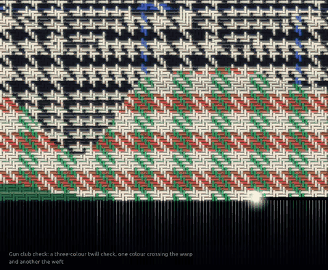

# Light Weaver

Threads of light weaving themselves into cloth, row by row, in the patterns of heritage textiles from around the world: tartan, tweed, double cloth, kente, kilim, ikat. Made to be watched, and eventually projected onto real surfaces.

Light Weaver is a working name. Inspired by Todd Moyer's Illoominated II; see [docs/vision.md](docs/vision.md).

The plan is in [docs/](docs/README.md); what has changed is in the [changelog](CHANGELOG.md).

## Run it

Needs Node.js 22.12 or newer (`.nvmrc` pins 24).

```sh
npm install
npm run dev      # then open the address it prints
npm test
npm run build    # static files in dist/
```

**See every design in the [design gallery](docs/designs.md), and each version in motion on the [screencasts page](docs/screencasts.md).**



With no address, it weaves every design in turn, each turning into the next. Move the mouse and a Settings button appears in the bottom right: choose designs and their order, colours, speed and more. A switch chooses whether changes wait for the Weave button or weave in straight away, for people who come to play with it. Every setting can also be given in the address:

- `?scene=houndstooth`: one design, by its name in the gallery. `?scene=tartan&seed=12` is a made-up tartan; leave out the seed for a new one each time.
- `?play=glen,satin,tartan`: the listed designs in turn. `?picks=200` sets how many rows each is woven for.
- `?sett=B6G6B6R2Y4`: your own tartan, with colours K (black), R, G, B, Y and W.
- `?colours=L-ff0000,P-9b4dff`: change a letter's colour in every design, or add new letters for a typed sett; `?colours.glen=L-ff0000` changes one design's. Each design's letters are in `src/scenes.ts`.
- `?blend=32` (rows a change between designs is spread over), `?speed=` (rows per second), `?cell=` (pixels per thread), `?caption=off`, and `?live=on` to weave changes in straight away.

## Licence

The code is under the [PolyForm Noncommercial License 1.0.0](LICENSE.md): free to use, change and share for any non-commercial purpose. The docs, pictures and videos are under [CC BY-NC 4.0](LICENSE-CONTENT.txt): share and adapt them for non-commercial purposes, crediting Eleanor Cox. For commercial use, ask.

Third-party material keeps its own terms, credited where it is used: for example, registered tartans remain Crown copyright (Scottish Register of Tartans).
