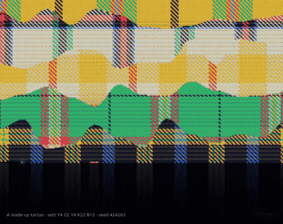
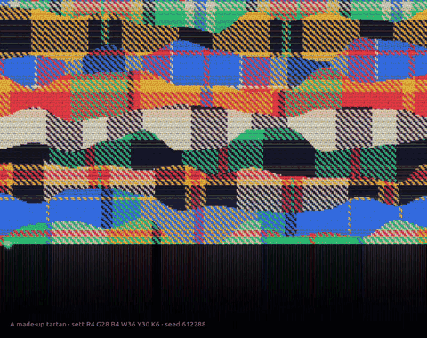
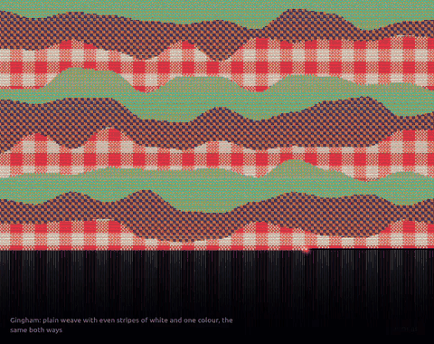
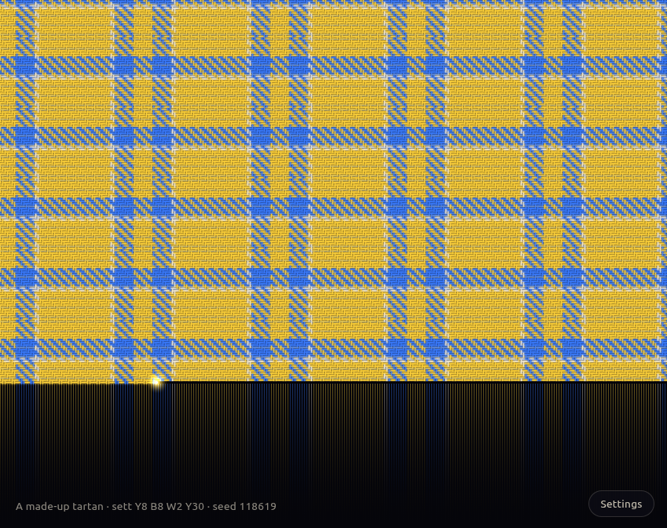
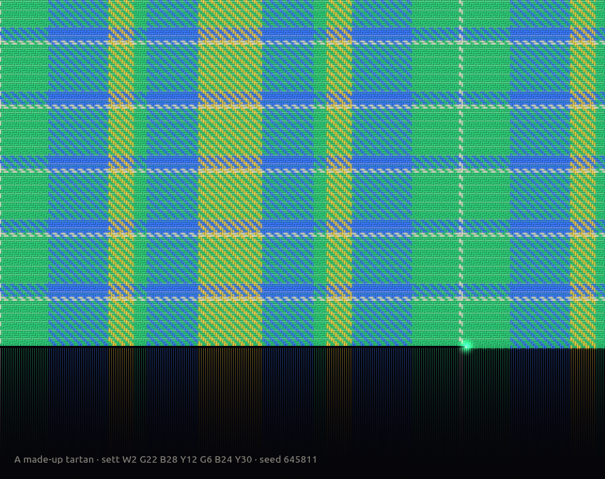
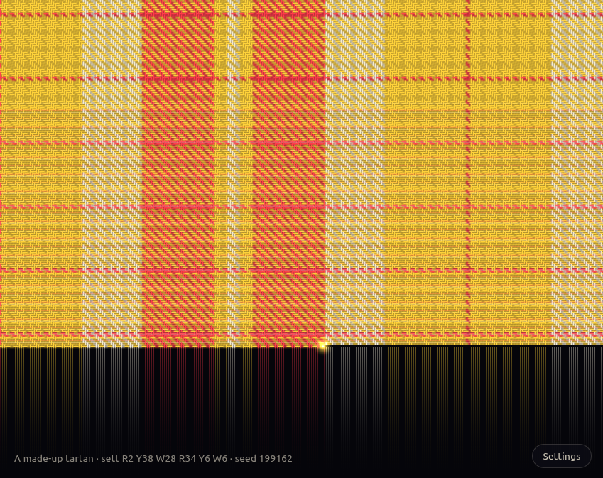
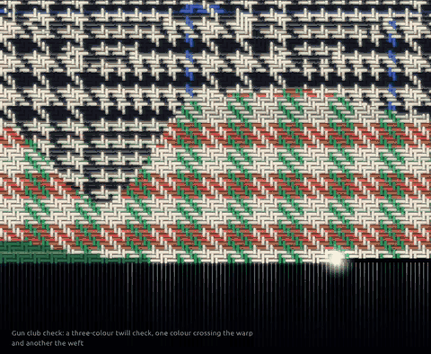
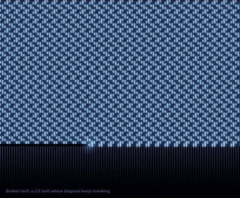
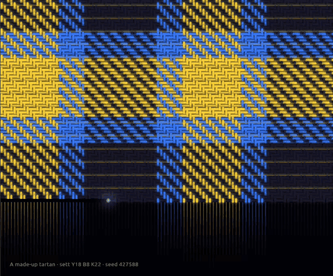
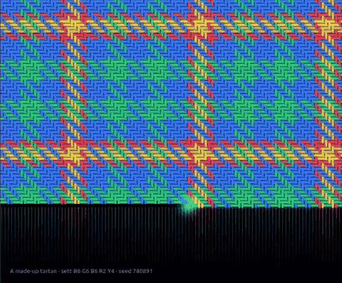

# Screencasts

Light Weaver as it has grown, one version at a time, newest first. Each GIF is made from a screencast Eleanor recorded, shrunk to load quickly here; long ones play faster than life. The full recordings are kept outside the repository, in `~/Videos/Screencasts/`, under the names given. What each version could do, and how it felt, is in the [version log](versions.md).

GIFs are made with `scripts/screencast-gif.py`, shared by all the projects and kept beside them in `~/Documents/code/scripts/`.

## v4: settings to play with

### Changing the weaving settings and the designs

The settings panel: choosing designs and changing speed, blend and thread size. Played four times faster.

From `Light Weaver v4 - settings, weaving and designs.webm`.

### A hundred made-up tartans, changing colours

A hundred made-up tartans in a row, their colours changed as they weave. Played three times faster.

From `Light Weaver v4 - 100 tartans, changing colours.webm`.

### Changing the order

Designs dragged into a new order. Played three times faster.

From `Light Weaver v4 - changing the order.webm`.

### Stills

Three made-up tartans: seeds 118619, 645811 and 199162.

## v3: one cloth into the next

Every design turning into the next along a soft wave, 30 rows each.

From `Light Weaver v3 - one cloth into the next.webm`.

## v2: one cloth after another

Designs one after another, with bare loom between.

From `Light Weaver v2 - one cloth after another.webm`.

## v1: first light

### First light

From `Light Weaver v1 - first light.webm`.

### A made-up tartan, seed 780891

Eleanor's first favourite: sett B6 G6 B6 R2 Y4.

From `Light Weaver v1 - made-up tartan 780891.webm`.
